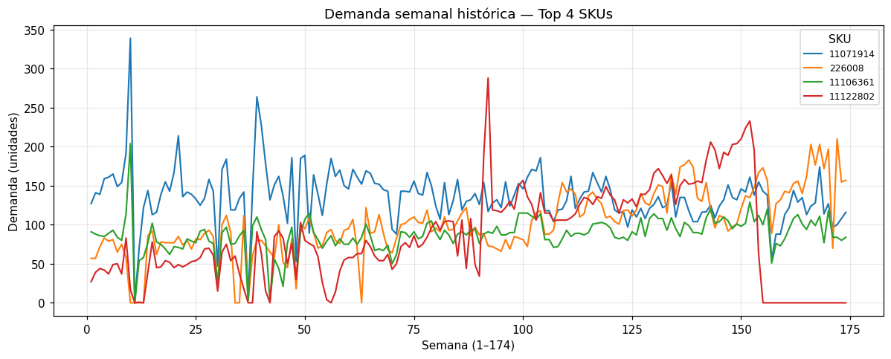
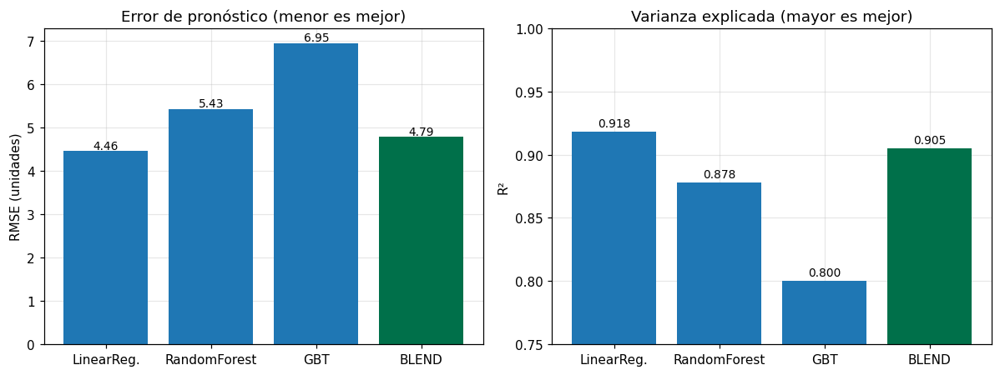
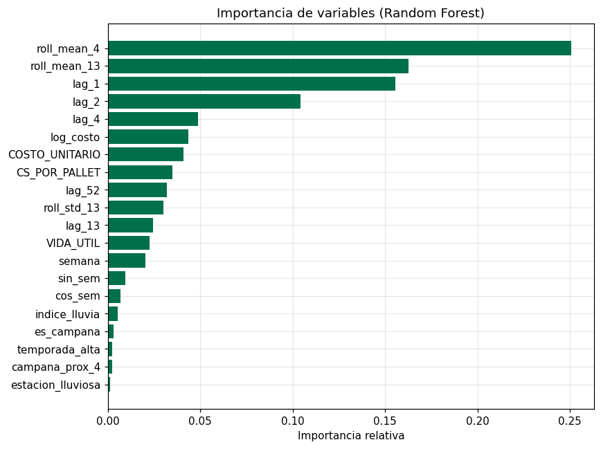
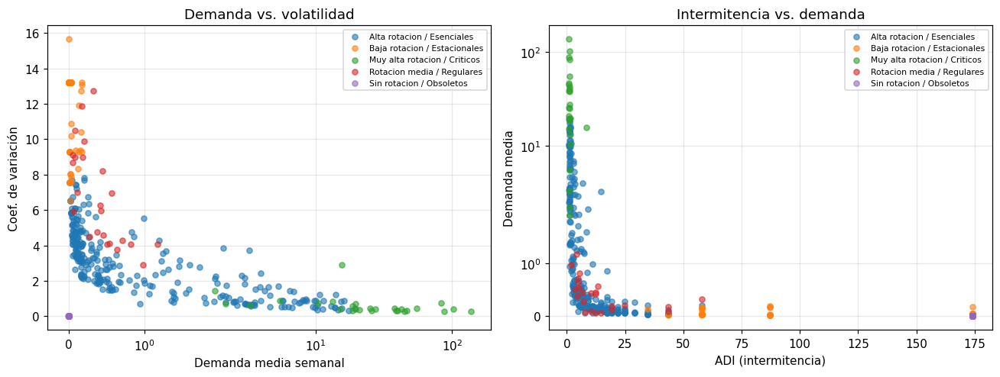
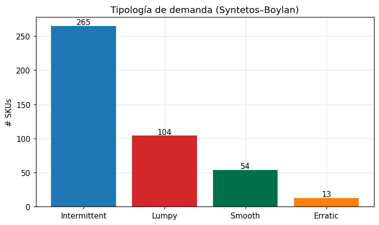
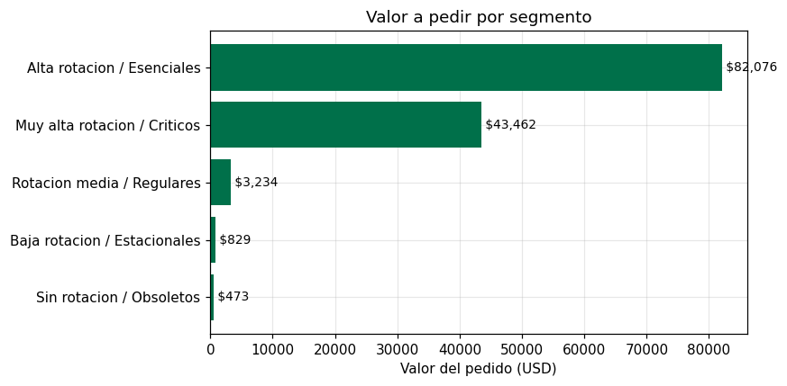
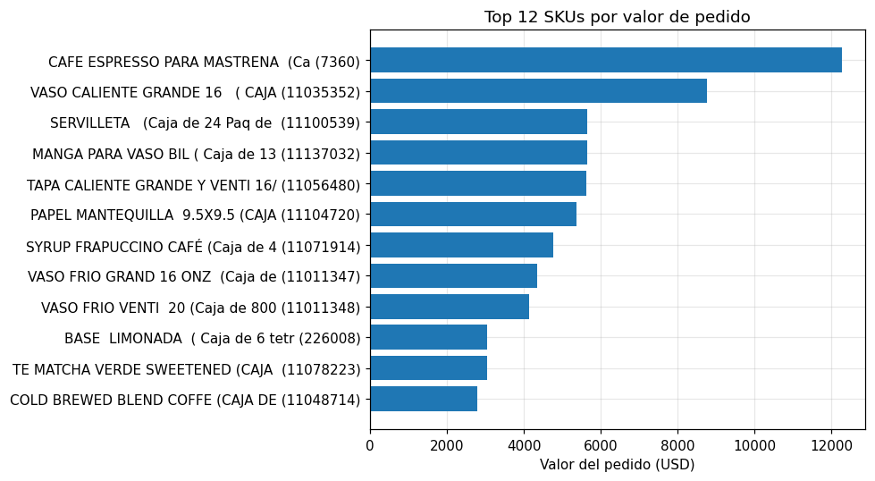
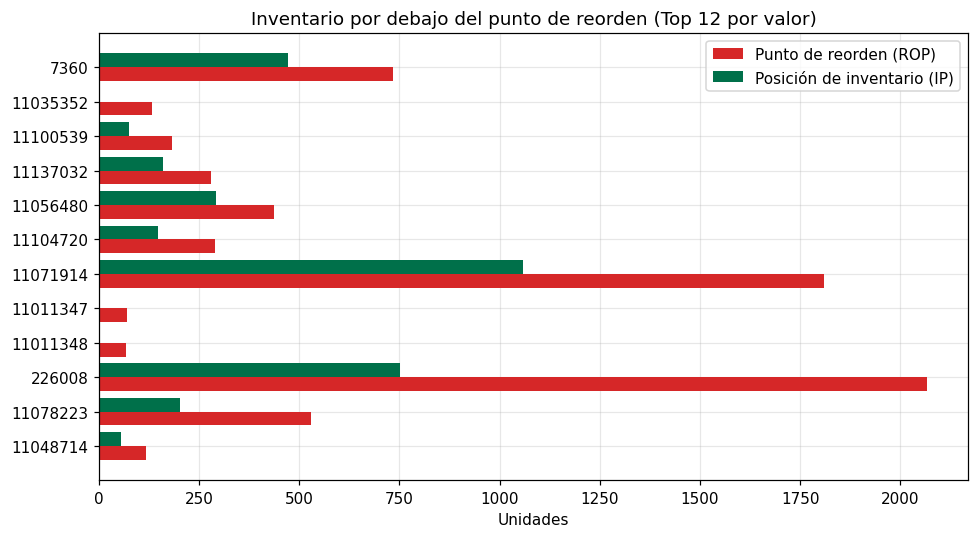

# Proyecto de cátedra – Analítica y tecnologías de Big Data
## Optimización de la cadena de suministro de Starbucks Costa Rica mediante PySpark

> Documento entregable. Las secciones siguen la rúbrica de evaluación. Los
> resultados numéricos provienen de la ejecución de los **cuatro notebooks** de
> `notebooks/` sobre los datos reales fusionados de `Analisis CR 44.xlsx` y
> `Analisis CR 30.xlsx` (**174 semanas** de historia continua, 2023-W1 →
> 2026-W18). La interfaz incorpora además dos módulos operativos para el ciclo
> de pedidos semanal (registro de consumo y confirmación de recepción).

---

## 1. Introducción, marco teórico y objetivos *(10 %)*

### 1.1 Introducción
La gestión de inventarios en una cadena de suministro de retail enfrenta dos
retos simultáneos: **anticipar la demanda** de cada producto para evitar quiebres
de stock o sobre-inventario, y **administrar la heterogeneidad del catálogo**,
donde conviven productos de altísima rotación con utilería de movimiento lento.
Este proyecto aplica tecnologías de Big Data (Apache Spark / PySpark) sobre los
datos operativos de Starbucks Costa Rica para abordar ambos retos combinando
varias técnicas de aprendizaje automático y un **modelo de inventario** que
responde *cuánto* y *cuándo* pedir considerando que el **tránsito desde la
colocación del pedido es de 3 meses (≈13 semanas)**.

### 1.2 Marco teórico
- **Apache Spark y el modelo de procesamiento distribuido.** Spark ejecuta
  transformaciones sobre *Resilient Distributed Datasets* y DataFrames de forma
  perezosa (*lazy evaluation*), optimizando el plan físico con Catalyst antes de
  materializar resultados. Se usa el formato columnar **Parquet** para persistir
  datos intermedios de manera eficiente.
- **Aprendizaje supervisado – Ensamble de regresores.** Se modela la demanda
  continua combinando **tres** algoritmos de MLlib: `LinearRegression`
  ($L_2$), `RandomForestRegressor` y `GBTRegressor`. Las predicciones se
  **mezclan** (*blending*) ponderando cada modelo por el inverso de su RMSE.
  Métricas: **RMSE**, **MAE** y **$R^2$**.
- **Características de serie temporal.** Rezagos (`lag` de 1, 2, 4, 13 y 52
  semanas), medias y desviaciones móviles (`roll_mean_4/13`, `roll_std_13`) y
  estacionalidad codificada con términos de Fourier ($\sin$, $\cos$ del ciclo
  anual de 52 semanas) calculadas con funciones de ventana de Spark.
- **Variables externas al histórico de demanda.** El pronóstico se enriquece con
  tres familias de señales exógenas: (i) **clima**, usando las *normales
  climatológicas* de precipitación del Valle Central de Costa Rica (San José) por
  mes y una bandera de estación lluviosa (mayo–noviembre), que capturan el efecto
  del clima sobre el tráfico de tienda y la mezcla de bebidas frías/calientes;
  (ii) **promociones**, con la campaña vigente, la *anticipación a campaña* (si el
  SKU entra en campaña en las próximas 4 semanas) y la temporada alta de retail
  (noviembre–diciembre); y (iii) **precio**, con el costo unitario y su
  transformación logarítmica $\log(1+\text{costo})$.
- **Validación cruzada temporal y ajuste de hiperparámetros.** En series de
  tiempo no es válido el `CrossValidator` con *folds* aleatorios porque mezclaría
  futuro y pasado (fuga de información). Se implementa una **validación cruzada
  de ventana expansiva** (*rolling/expanding origin*): cada *fold* entrena con
  todas las semanas hasta un corte y valida con el bloque inmediatamente
  posterior. Se promedia el RMSE de los *folds* y se elige, por algoritmo, la
  combinación de hiperparámetros de menor error; el ensamblado y la
  estandarización se re-ajustan **dentro de cada *fold* de entrenamiento** para
  no filtrar información del periodo de validación.
- **Aprendizaje no supervisado – Clustering comparado.** Se comparan `KMeans`,
  `BisectingKMeans` y `GaussianMixture` por **coeficiente de silueta**, y se
  clasifica la demanda con la tipología de **Syntetos–Boylan** (Smooth /
  Erratic / Intermittent / Lumpy) según el intervalo medio entre demandas
  (ADI) y el $CV^2$ del tamaño de pedido.
- **Modelo de inventario (punto de reorden).** Con la demanda esperada $\mu$ y
  su desviación $\sigma$ del pronóstico se calcula el **stock de seguridad**
  $SS = z\,\sigma\sqrt{L}$, el **punto de reorden** $ROP = \mu L + SS$ y la
  **posición de inventario** $IP$ = existencias + tránsito, con lead time
  $L=13$ semanas.
- **Ingeniería de características.** Estandarización (media 0, desviación 1) y
  ensamblado de vectores (`VectorAssembler`) dentro de *pipelines* reproducibles
  de Spark MLlib.

### 1.3 Objetivos
**General:** Construir una solución analítica de Big Data que apoye la toma de
decisiones de abastecimiento de Starbucks Costa Rica.

**Específicos:**
1. Integrar y limpiar las fuentes operativas dispersas (dos exportaciones
   Excel, CR 44 y CR 30) en un único dataset analítico con **174 semanas** de
   historia continua.
2. **(Supervisado)** Predecir la demanda semanal por SKU con un **ensamble** de
   regresión lineal, random forest y gradient boosting, enriquecido con
   **variables externas** (clima, promociones y precio) y con hiperparámetros
   ajustados por **validación cruzada temporal**.
3. **(No supervisado)** Segmentar el catálogo de SKUs comparando varios
   algoritmos de clustering y clasificar la tipología de demanda.
4. **(Optimización)** Mezclar el pronóstico con un modelo de inventario para
   recomendar **cuánto y cuándo pedir** considerando el tránsito de 3 meses.
5. Traducir los resultados técnicos a impacto de negocio (costos en USD,
   políticas operativas).

---

## 2. Descripción del problema *(10 %)*

Starbucks Costa Rica gestiona un catálogo de **436 SKUs** activos abastecidos por
múltiples proveedores. El equipo de planeación dispone de:
- Un histórico de **174 semanas** continuas de demanda por SKU.
- Atributos logísticos por producto (costo unitario, vida útil, unidades por
  pallet, factor de empaque).
- Inventario **en mano** (`EXIST_W11`) y **en tránsito** (`TRANSITO`) por SKU.
- Calendario de **campañas estacionales** (Navidad, Halloween, etc.) que
  generan picos de demanda.
- Una clasificación de sostenibilidad (BIO: *Core* / *PLA*).

**Problemas concretos:**
- **Quiebres de stock en campañas:** la demanda se dispara y las compras
  reactivas llegan tarde. Se requiere un **pronóstico** confiable.
- **Política de inventario única para todo el catálogo:** productos muy
  distintos (alta rotación vs. utilería lenta) se gestionan igual, inmovilizando
  capital. Se requiere **segmentar**.
- **Tránsito largo (3 meses):** al pedir, el producto tarda ≈13 semanas en
  llegar; hay que decidir **cuándo** disparar el pedido y **cuánto** pedir antes
  de quedar sin inventario.

Los datos de origen estaban en **dos exportaciones Excel desordenadas**
(`Analisis CR 44.xlsx`, con la historia hasta 2025, y `Analisis CR 30.xlsx`, con
la actualización hasta 2026) con hojas, encabezados desplazados y columnas
semanales de tipos mixtos distintos entre sí. Se fusionaron empalmando las
semanas comunes (la superposición validó una correlación de 0.99 y un 99.6 % de
valores idénticos), lo que motivó una fase de ingeniería de datos previa.

---

## 3. Desarrollo de la solución *(45 %)*

### 3.1 Arquitectura y entorno
- **PySpark 4.1.2** en modo local (`local[*]`), con JDK 17 y `winutils` para
  Windows. Persistencia intermedia en **Parquet** (`data/parquet/`).
- Flujo en cuatro notebooks reproducibles:

```
extract_data.py  ──►  data/*.csv
        │
        ▼
01_eda_data_engineering.ipynb  ──►  data/parquet/{demanda_larga, historico, inf, bio}
        │
        ├──►  02_regression_demand_forecasting.ipynb  (ensamble LR+RF+GBT) ──► parquet/forecast_sku
        │                                                                      │
        ├──►  03_kmeans_sku_segmentation.ipynb        (clustering comparado) ──► parquet/segmentos_sku
        │                                                                      │
        └──►  04_reorder_policy.ipynb  (mezcla pronóstico + inventario) ◄───┘ ──► parquet/plan_reabastecimiento
```

### 3.2 Ingeniería de datos — Notebook 01
1. Carga de los CSV limpios (histórico, atributos `inf`, campañas, `bio`).
2. **Transformación ancho → largo:** las **174** columnas semanales
   (`wk1..wk174`) se convierten a formato largo `[SKU, semana, demanda]` con
   `stack()`, generando **75 864 filas** (436 SKU × 174 semanas). El número de
   semanas se detecta de forma **dinámica** (regex `wk\d+`) para no depender de
   un valor fijo. *(Cada columna semanal se castea a `double` porque `stack()`
   exige tipos homogéneos.)*
3. Imputación de nulos y **enriquecimiento** con costo unitario, vida útil,
   unidades por pallet, inventario en mano/tránsito y una bandera `es_campana`.
4. Persistencia en Parquet para reutilización por los modelos.



*Figura 1. Demanda semanal de los 4 SKUs de mayor volumen a lo largo de las 174
semanas. Se observan los picos estacionales y la fuerte heterogeneidad entre
productos que motiva tanto el pronóstico como la segmentación.*

### 3.3 Modelo supervisado — Ensamble de demanda (Notebook 02)
- **Variable objetivo:** `demanda` semanal por SKU.
- **Características (20):** agrupadas en cuatro familias:
  - *Serie temporal (11):* rezagos `lag_1, lag_2, lag_4, lag_13, lag_52`,
    medias/desviaciones móviles `roll_mean_4, roll_mean_13, roll_std_13`,
    estacionalidad `sin_sem, cos_sem` y tendencia `semana`.
  - *Promociones (3):* `es_campana` (campaña vigente), `campana_prox_4`
    (anticipación a campaña en las próximas 4 semanas) y `temporada_alta`
    (noviembre–diciembre).
  - *Clima (2):* `indice_lluvia` (normales de precipitación de Costa Rica por
    mes) y `estacion_lluviosa` (mayo–noviembre).
  - *Precio y producto (4):* `COSTO_UNITARIO`, `log_costo`, `VIDA_UTIL`,
    `CS_POR_PALLET`. Todas construidas con
    `Window.partitionBy("SKU").orderBy("semana")`.
- **Pipeline:** `VectorAssembler → StandardScaler` y **tres** modelos en
  paralelo: `LinearRegression`, `RandomForestRegressor` y `GBTRegressor`.
- **Ajuste de hiperparámetros con validación cruzada temporal:** una **ventana
  expansiva** de dos *folds* (cortes en las semanas 135 y 148) recorre rejillas
  de búsqueda por algoritmo (`regParam`/`elasticNetParam` para LR; `numTrees`/
  `maxDepth` para RF; `maxIter`/`maxDepth` para GBT) eligiendo, por menor RMSE
  promedio, la mejor combinación. El ensamblado y la estandarización se
  re-ajustan dentro de cada *fold* de entrenamiento para evitar fuga de
  información.
- **Mezcla (blending):** las predicciones se combinan ponderando por el inverso
  del RMSE de cada modelo y se acotan a 0.
- **Partición temporal:** entrenamiento con semanas ≤ 161 (47 524 filas), prueba
   con las últimas **13** semanas > 161 (5 668 filas), simulando el horizonte de
  un ciclo de reabastecimiento.

### 3.4 Modelo no supervisado — Segmentación de SKUs (Notebook 03)
- **Unidad de análisis:** un vector por SKU (436 en total).
- **Características:** demanda media, coeficiente de variación `cv`, pendiente
  de tendencia `slope` (mínimos cuadrados cerrados), intermitencia `ADI`,
  `cv2_nz`, fracción de semanas en campaña, costo unitario y vida útil.
- **Pipeline:** `VectorAssembler → StandardScaler` y comparación de **KMeans**,
  **BisectingKMeans** y **GaussianMixture** para $k = 3,4,5$ por silueta.
- **Tipología de demanda (Syntetos–Boylan):** clasificación Smooth / Erratic /
  Intermittent / Lumpy según umbrales `ADI=1.32` y `CV²=0.49`.

### 3.5 Optimización — Política de reabastecimiento (Notebook 04)
Este notebook **mezcla los tres modelos**: el pronóstico (`forecast_sku`), la
segmentación (`segmentos_sku`) y un modelo de inventario de revisión periódica:
- Lead time $L=13$ semanas (tránsito de 3 meses), revisión $R=4$ semanas.
- **Nivel de servicio diferenciado por segmento** (mejora respecto a un $z$
  único), escalonado en cinco niveles según la criticidad del SKU: críticos
  $z=1.96$ (97.5 %), esenciales $z=1.81$ (96.5 %), regulares $z=1.65$ (95 %),
  estacionales $z=1.28$ (90 %) y obsoletos $z=1.04$ (85 %). Así se protege más el
  inventario crítico y se libera capital en la cola de baja rotación.
- Demanda en tránsito $DDLT=\mu L$; stock de seguridad $SS=z\sigma\sqrt{L}$;
  punto de reorden $ROP=DDLT+SS$; posición de inventario
  $IP=\text{EXIST\_W11}+\text{TRANSITO}$.
- **Pedir ahora** si $IP \le ROP$; **cantidad** $Q=\max(0, S-IP)$ con nivel
  objetivo $S=\mu(L+R)+SS$, **redondeada a cajas completas** (múltiplos del
  factor de empaque, sin quedar por debajo del nivel objetivo) y traducida a
  valor en USD.

*(Nota de implementación: en Windows las UDF de Python provocan el error
"Python worker failed to connect back"; toda la lógica se implementó con
expresiones `F.when()` en lugar de UDF.)*

### 3.6 Interfaz del plan de compras (`app.py`)
Para que el área de compras consuma el resultado sin tocar código, se desarrolló
un **dashboard interactivo en Streamlit** que lee `plan_reabastecimiento_csv`:
- **Indicadores (KPIs):** SKUs en catálogo, SKUs a pedir ahora, valor total y
  valor de la selección filtrada.
- **Filtros:** por segmento, tipología de demanda, proveedor, búsqueda por
  SKU/descripción y casilla "solo pedir ahora".
- **Gráficas:** valor por segmento, SKUs por tipología y top 15 por valor.
- **Tabla accionable** con la orden de compra y **botón de descarga CSV**.

La interfaz se organiza en **tres pestañas** que cierran el ciclo operativo
semanal:
1. **Plan de compras:** la vista del modelo descrita arriba.
2. **Consumo semanal:** una tabla editable donde el planeador ingresa las
   unidades consumidas por SKU en la semana; el sistema descuenta ese consumo de
   las existencias y **recalcula el pedido en pandas** (misma fórmula de ROP y
   redondeo a cajas), sin volver a correr Spark. Los consumos se persisten en
   `data/movimientos/consumo_semanal.csv`.
3. **Confirmar recepción:** una tabla editable para registrar las unidades que
   llegaron; lo recibido se descuenta del tránsito y se suma a las existencias,
   actualizando la posición de inventario que alimenta el recálculo. Las
   recepciones se persisten en `data/movimientos/recepciones.csv`.

Se ejecuta con `python -m streamlit run app.py`.

---

## 4. Análisis de resultados *(25 %)*

### 4.1 Modelo supervisado de demanda (ensamble)

**Hiperparámetros óptimos** elegidos por validación cruzada temporal:
`LinearRegression(regParam=0.01, elasticNetParam=0.5)`,
`RandomForest(numTrees=120, maxDepth=10)` y `GBT(maxIter=80, maxDepth=4)`.

| Modelo | RMSE | MAE | $R^2$ |
|---|---|---|---|
| LinearRegression | 4.46 | 1.27 | **0.918** |
| RandomForest | 5.43 | 1.43 | 0.878 |
| GBT | 6.95 | 1.73 | 0.800 |
| **BLEND (mezcla)** | 4.79 | 1.34 | 0.905 |



*Figura 2. RMSE y $R^2$ de los tres regresores y de la mezcla en las últimas 13
semanas de prueba.*

- Sobre **174 semanas** todos los modelos superan $R^2 = 0.80$ en el periodo de
  prueba (últimas 13 semanas, nunca vistas). La regresión lineal regularizada es
  la más precisa ($R^2 = 0.92$) y la **mezcla** ofrece un resultado robusto y
  estable ($R^2 = 0.905$); el ajuste por validación cruzada temporal mejoró el
  Random Forest (de 0.858 a **0.878**) y la mezcla (de 0.904 a **0.905**).
- **Importancia de variables (Random Forest):** dominan las **medias móviles**
  `roll_mean_4` (0.251) y `roll_mean_13` (0.163), junto con el rezago `lag_1`
  (0.156). Entre las **variables externas**, el precio aparece con peso
  apreciable (`log_costo` 0.043 y `COSTO_UNITARIO` 0.041), por encima de la
  estacionalidad anual; las señales de clima y promoción aportan de forma
  marginal pero consistente. Es decir, la inercia reciente de cada SKU sigue
  siendo el mejor anticipador, complementada por el nivel de precio del producto.



*Figura 3. Importancia relativa de las 20 variables según el Random Forest.*
- **Traducción a negocio:** el pronóstico por SKU (`forecast_sku`) entrega la
  demanda esperada $\mu$ y su desviación $\sigma$, insumos directos del modelo
  de inventario. Un error de predicción equivale a **capital inmovilizado**
  (sobreestimación) o **ventas perdidas** (subestimación).

### 4.2 Segmentación de SKUs
- **Comparación de algoritmos:** `KMeans` con **$k=5$** obtuvo la mejor silueta
  (**0.464**), superando a `GaussianMixture`; `BisectingKMeans` colapsó a
  un solo grupo por la fuerte asimetría de la demanda.

| Segmento | # SKUs | Demanda prom. | CV | ADI | Costo unit. |
|---|---|---|---|---|---|
| **Muy alta rotación / Críticos** | 27 | 35.45 | 0.60 | 1.37 | $3.60 |
| **Alta rotación / Esenciales** | 275 | 2.01 | 2.92 | 9.45 | $15.96 |
| **Rotación media / Regulares** | 24 | 0.40 | 6.76 | 14.6 | $14.24 |
| **Baja rotación / Estacionales** | 49 | 0.04 | 11.08 | 114.3 | $27.91 |
| **Sin rotación / Obsoletos** | 61 | 0.00 | 0.00 | 174.0 | $14.15 |



*Figura 4. Los cinco segmentos en los planos demanda–volatilidad e
intermitencia–demanda. KMeans separa con claridad los pocos SKUs de alto volumen
de la larga cola de baja rotación hasta los productos sin rotación.*

**Tipología de demanda (Syntetos–Boylan):**

| Tipología | # SKUs | Interpretación |
|---|---|---|
| Intermittent | 265 | Demanda espaciada y de tamaño estable |
| Lumpy | 104 | Demanda espaciada y muy variable (la más difícil) |
| Smooth | 54 | Demanda frecuente y estable (fácil de pronosticar) |
| Erratic | 13 | Demanda frecuente pero de tamaño variable |



*Figura 5. Distribución del catálogo por tipología de demanda.*

**Interpretación de negocio:**
- *Muy alta / Críticos:* pocos productos (27) con la mayor demanda → **reposición
  frecuente y stock de seguridad alto**.
- *Baja rotación / Estacionales* y *Sin rotación / Obsoletos:* intermitencia muy
  alta (ADI > 100) y demanda mínima → **compras bajo pedido o depuración** para
  no inmovilizar capital.
- Los SKUs *Smooth* (54) admiten pronóstico automático fiable; los *Lumpy* (104)
  requieren mayor stock de seguridad o gestión manual.

### 4.3 Política de reabastecimiento (cuánto y cuándo pedir)
Combinando el pronóstico, la segmentación y el modelo de inventario con lead
time de 13 semanas y **nivel de servicio diferenciado**, el plan recomienda:
- **260 de 436 SKUs (60 %)** están en o por debajo de su punto de reorden y
  deben **pedirse ahora**.
- **Valor total del pedido sugerido: ~$130 074**, priorizado por urgencia
  (semanas hasta cruzar el ROP) y valor. El mayor monto corresponde al **café
  espresso para Mastrena** (SKU 7360 ≈ $12 267) y a los vasos calientes de alto
  volumen.
- El **63 % del valor** se concentra en el segmento *Alta rotación / Esenciales*
  (163 SKUs, ~$82 076) y otro **33 %** en *Muy alta rotación / Críticos*
  (27 SKUs, ~$43 462), confirmando dónde enfocar el capital de compra.
- La cantidad a pedir se **redondea a cajas completas** para que la orden sea
  directamente ejecutable por el área de compras.
- Para cada SKU se entrega: punto de reorden, stock de seguridad, posición de
  inventario, **cantidad a pedir** (unidades y cajas), valor en USD y semanas de
  cobertura restante — una orden de compra accionable.



*Figura 6. Distribución del valor del pedido por segmento.*



*Figura 7. Los 12 SKUs de mayor valor de pedido en el plan actual.*



*Figura 8. Para los 12 SKUs de mayor valor, la posición de inventario (verde)
está por debajo del punto de reorden (rojo): de ahí la necesidad de pedir.*

### 4.4 Justificación de las técnicas
El **ensamble de regresores** (supervisado) responde *“¿cuánto se venderá?”*; el
**clustering** (no supervisado) responde *“¿cómo agrupar el catálogo?”*; y el
**modelo de inventario** combina ambos para responder *“¿cuánto y cuándo
pedir?”*. Son complementarios: el pronóstico alimenta la operación semanal, la
segmentación define la política estructural y el reorden ejecuta las compras.

---

## 5. Recursos utilizados y conclusiones *(10 %)*

### 5.1 Recursos

**Recursos de desarrollo (entorno actual del proyecto).**
- **Software:** Python 3.13, Apache Spark / PySpark 4.1.2 (MLlib), Pandas,
  Matplotlib, **Streamlit**, JDK 17, `winutils`/Hadoop para Windows, Parquet,
  Jupyter en VS Code, `nbconvert` para ejecución reproducible.
- **Hardware de desarrollo:** una estación de trabajo (CPU multinúcleo, 16 GB de
  RAM) en modo Spark `local[*]` con `spark.driver.memory=3g`. Suficiente para
  los ~75 864 registros (436 SKU × 174 semanas) del histórico.
- **Datos:** `Analisis CR 44.xlsx` y `Analisis CR 30.xlsx` (operación de
  Starbucks Costa Rica), fusionados en un único histórico de 174 semanas.

**Recursos para un despliegue en producción.** Para operar el pipeline de forma
recurrente (recálculo semanal del plan) se recomienda:
- **Cómputo en la nube:** un clúster Spark gestionado (p. ej. Databricks, AWS EMR
  o Google Dataproc). Dado el volumen actual basta un clúster pequeño: 1 *driver*
  + 2 *workers* de 4 vCPU / 16 GB; con autoescalado puede crecer si se incorporan
  más países o mayor granularidad (SKU × tienda). Costo aproximado de unas pocas
  horas de cómputo por semana (orden de **USD 50–150/mes** según proveedor y
  tiempos de encendido).
- **Almacenamiento:** un *data lake* en object storage (S3 / ADLS / GCS) con las
  capas Parquet *bronze/silver/gold*, y una base ligera (PostgreSQL) para servir
  el plan a la interfaz.
- **Orquestación:** un planificador (Airflow, Databricks Workflows o Azure Data
  Factory) que dispare semanalmente la cadena `extract → 01 → 02/03 → 04 →
  figuras`.
- **Servicio de la interfaz:** Streamlit desplegado en un contenedor (Docker)
  sobre un servicio administrado (App Service / ECS / Cloud Run).
- **Perfiles humanos:** 1 *data engineer* (ingesta y pipelines), 1 *ML engineer /
  científico de datos* (modelos y validación), 1 *analista de negocio / planeador
  de demanda* (interpretación y operación del plan). Apoyo puntual de un *DevOps*
  para la nube.
- **Tiempo estimado de implantación productiva:** ~6–8 semanas (2 de ingesta y
  modelado, 2 de orquestación y despliegue, 2 de pruebas con el negocio y ajuste,
  el resto de estabilización).

### 5.2 Conclusiones
1. PySpark permitió construir un flujo reproducible de ingeniería de datos sobre
   **174 semanas** (fusión de dos exportaciones Excel) y varios modelos de ML
   sobre datos operativos reales.
2. El **ensamble** de demanda alcanzó **$R^2 = 0.92$** (mejor modelo) y **0.905**
   en la mezcla, en un horizonte futuro de 13 semanas, con las **medias
   móviles** del SKU como predictor clave y el **precio** como variable externa
   más influyente; los hiperparámetros se ajustaron por **validación cruzada
   temporal** para evitar fuga de información. Es suficientemente preciso para
   apoyar la planeación.
3. La segmentación comparó tres algoritmos y eligió **KMeans $k=5$** (silueta
   0.464); junto con la tipología Syntetos–Boylan habilita políticas de
   inventario diferenciadas en cinco niveles de servicio.
4. El **modelo de reabastecimiento** mezcla los tres modelos y, con un lead time
   de 13 semanas, nivel de servicio diferenciado por segmento y redondeo a cajas
   completas, identifica **260 SKUs** a pedir de inmediato (~$130 074),
   concentrando el 96 % del valor en los productos esenciales y críticos.
5. La **interfaz Streamlit** entrega el plan al área de compras de forma
   interactiva (filtros, KPIs y descarga de la orden) e incorpora dos módulos
   operativos — **registro de consumo semanal** (que recalcula el pedido) y
   **confirmación de recepción** — cerrando el ciclo semanal entre el modelo y
   la operación.

### 5.3 Trabajo futuro
- Incorporar señales de clima **medido en tiempo real** (API meteorológica) y el
  calendario oficial de promociones del ERP, complementando las normales
  climatológicas y las banderas de campaña ya integradas.
- Extender la granularidad del pronóstico a **SKU × tienda** y evaluar modelos de
  series temporales específicos (p. ej. modelos jerárquicos o de *gradient
  boosting* por horizonte) frente al ensamble actual.
- Conectar la interfaz directamente al ERP de compras y automatizar la
  orquestación del pipeline semanal.

---

## Anexo A — Cómo reproducir
```powershell
python -m pip install -r requirements.txt
python extract_data.py
# Ejecutar en orden: notebooks/01, 02, 03, 04 (reiniciar kernel entre notebooks)
python generar_graficas.py          # genera las figuras del informe
python -m streamlit run app.py       # abre la interfaz del plan de compras
```

## Anexo B — Código fuente

El código fuente completo se entrega junto con este informe. A continuación se
listan los archivos y su responsabilidad, seguidos de los fragmentos clave de
los algoritmos descritos en el desarrollo.

| Archivo | Responsabilidad |
|---|---|
| `extract_data.py` | Lectura y fusión de los Excel CR 44 + CR 30; genera los CSV base (histórico de 174 semanas, atributos, campañas, calendario). |
| `notebooks/01_eda_data_engineering.ipynb` | Ingeniería de datos: ancho→largo, imputación, enriquecimiento y persistencia en Parquet (`demanda_larga`). |
| `notebooks/02_regression_demand_forecasting.ipynb` | Ensamble supervisado (LR+RF+GBT) con variables externas y validación cruzada temporal; produce `forecast_sku`. |
| `notebooks/03_kmeans_sku_segmentation.ipynb` | Segmentación no supervisada (KMeans/Bisecting/GMM) y tipología Syntetos–Boylan; produce `segmentos_sku`. |
| `notebooks/04_reorder_policy.ipynb` | Política de inventario (ROP, stock de seguridad, cuánto/cuándo pedir); produce el plan de reabastecimiento. |
| `app.py` | Interfaz Streamlit (plan de compras + consumo semanal + confirmación de recepción). |
| `generar_graficas.py` | Genera las ocho figuras del informe. |

**B.1 Variables externas (Notebook 02).** Clima por normales climatológicas de
Costa Rica, anticipación a campaña y precio:

```python
# Clima: normales de precipitación (mm) del Valle Central por mes
lluvia_norm = {1:6.0, 2:10.0, 3:14.0, 4:80.0, 5:230.0, 6:280.0,
               7:180.0, 8:220.0, 9:305.0, 10:345.0, 11:130.0, 12:35.0}
expr_lluvia = F.lit(35.0)
for m, mm in lluvia_norm.items():
    expr_lluvia = F.when(F.col("mes") == m, F.lit(mm)).otherwise(expr_lluvia)
df = df.withColumn("indice_lluvia", expr_lluvia)
df = df.withColumn("estacion_lluviosa", F.when(F.col("mes").between(5, 11), 1).otherwise(0))
# Promociones: anticipación a campaña (próximas 4 semanas) y temporada alta
w_lead4 = Window.partitionBy("SKU").orderBy("semana").rowsBetween(1, 4)
df = df.withColumn("campana_prox_4", F.max("es_campana").over(w_lead4))
df = df.withColumn("temporada_alta", F.when(F.col("mes").isin(11, 12), 1).otherwise(0))
# Precio: costo unitario y su transformación logarítmica
df = df.withColumn("log_costo", F.log1p(F.col("COSTO_UNITARIO")))
```

**B.2 Validación cruzada temporal de ventana expansiva (Notebook 02).** Re-ajusta
el preprocesamiento dentro de cada *fold* para evitar fuga de información:

```python
FOLDS = [(135, 136, 148), (148, 149, 161)]  # (corte_train, ini_valid, fin_valid)

def _prep_fit(df_train):
    a = VectorAssembler(inputCols=FEATURES, outputCol="rawFeatures")
    s = StandardScaler(inputCol="rawFeatures", outputCol="features", withMean=True, withStd=True)
    return Pipeline(stages=[a, s]).fit(df_train)

def cv_temporal(constructor, grid):
    resultados = []
    for combo in grid:
        rmses = []
        for tr_end, va_ini, va_fin in FOLDS:
            tr = feat.filter((F.col("semana") > 52) & (F.col("semana") <= tr_end))
            va = feat.filter((F.col("semana") >= va_ini) & (F.col("semana") <= va_fin))
            pm = _prep_fit(tr)
            modelo = constructor(combo).fit(pm.transform(tr))
            p = modelo.transform(pm.transform(va)).withColumn(
                "prediction", F.greatest(F.lit(0.0), F.col("prediction")))
            rmses.append(ev_rmse.evaluate(p))
        resultados.append((combo, sum(rmses) / len(rmses)))
    resultados.sort(key=lambda x: x[1])
    return resultados
```

**B.3 Punto de reorden y cantidad a pedir (Notebook 04).** Nivel de servicio
diferenciado por segmento y redondeo a cajas completas:

```python
SS  = z_aplicado * sigma * sqrt(L)          # stock de seguridad
ROP = mu * L + SS                            # punto de reorden
IP  = EXIST_W11 + TRANSITO                   # posición de inventario
S   = mu * (L + R) + SS                       # nivel objetivo
pedir_ahora   = (IP <= ROP)
cantidad_unid = ceil(max(0, S - IP) / FACTOR) * FACTOR   # cajas completas
```
